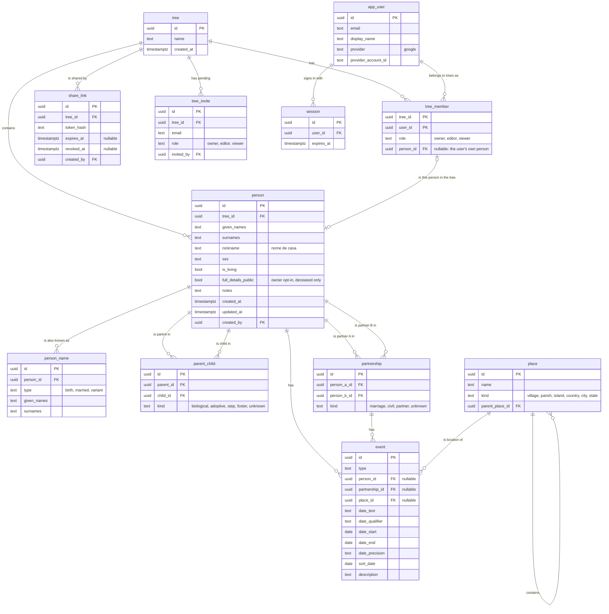

# Data model

> **Provisional.** The fields on `person`, `event` and `place` are a first draft, to be settled in a dedicated nodes design session before coding starts. Open items for that session include the list of event types, whether places are per tree or shared across trees, and how open-ended dates ("after 1880") count towards the 110-year living rule. The access tables (`tree`, `tree_member`, `share_link`, `app_user`) follow [ADR-0008](decisions/0008-oauth-only-sign-in.md) and [ADR-0009](decisions/0009-per-tree-roles-and-protected-view.md).

A family tree is a graph, not a tree. Every child has two parents, people have several partners over a lifetime, and marriages between relatives make the same ancestor appear more than once (pedigree collapse). Nôs Raiz therefore stores **people as nodes** and **relationships as typed edges** in their own tables. No person record points to its parents directly. See [ADR-0002](decisions/0002-model-family-graph-as-edge-tables.md).

## Entity relationship diagram



All IDs are UUIDv7, generated by the application: time-ordered, so indexes stay compact and rows sort by creation.

## Tables

### Access: `tree`, `tree_member`, `share_link`, `app_user`

- **`tree`** is the unit of access. Every person belongs to one tree. The MVP has one tree; the platform will have many.
- **`tree_member`** gives a user a role (`owner`, `editor`, `viewer`) in a tree. A user can be a member of many trees. `person_id` optionally links the user to themselves in that tree, for "how am I related to…". Every tree has at least one owner.
- **`share_link`** lets anyone with the link view a tree in the protected view. Only a hash of the token is stored, so a database leak does not leak working links.
- **`app_user`** is a Google identity (other OAuth providers later). There is no password column, ever. See [ADR-0008](decisions/0008-oauth-only-sign-in.md).

- **`tree_invite`** holds pending invitations: an email invited to a tree before that person has signed in. It becomes a `tree_member` on their first Google sign-in.
- **`session`** holds server-side sessions. The cookie carries only the session ID.

**Same-tree rule:** a `parent_child` or `partnership` row may only link two people in the same tree (enforced in the service layer).

Who sees which fields is defined in [ADR-0009](decisions/0009-per-tree-roles-and-protected-view.md) and summarised in the [security overview](../security/overview.md#what-each-role-sees).

### `person`

One row per individual. Names here are the primary (usually birth) name; variants live in `person_name`.

- `nickname` holds the *nome de casa*, which is often how someone is actually known in Cape Verde.
- `is_living`: new people default to living. The service layer sets it to `false` when a death or burial event is added, or when the birth `sort_date` is more than 110 years ago. Editors can override it either way.
- `full_details_public`: an owner can set it on a person with a recorded **death or burial event**, to show their full details to everyone who can see the tree. `is_living = false` alone is not enough. Removing the last death or burial event clears it.

### `person_name`

Alternate names for search and display: married names, spelling variants across Portuguese, Cape Verdean and US records (Gonçalves, Goncalves, Gonsalves).

### `parent_child`

The core edge. One row per parent–child link.

- `kind` distinguishes biological, adoptive, step, foster and unknown, so a child can have biological and adoptive parents at once.
- Unique on `(parent_id, child_id)`; check constraint `parent_id <> child_id`.
- Business rules enforced in the service layer: at most two biological parents per child, and no person may be their own ancestor (no cycles).

### `partnership`

A union between two people. Multiple partnerships per person are normal. The same pair may have more than one row (for example, divorced and remarried). Marriage, divorce and other dates are `event` rows linked by `partnership_id`.

Children are **not** attached to a partnership. A child's parents are its `parent_child` rows; the UI groups children under a partnership when both partners are the child's parents. This keeps single-parent and unknown-parent cases simple.

### `event`

A dated fact about a person (birth, baptism, death, burial, emigration, residence) or a partnership (marriage, divorce). Exactly one of `person_id` or `partnership_id` is set (check constraint).

### `place`

Places form a hierarchy through `parent_place_id`:

```
Cabo Verde (country)
└── Brava (island)
    └── Nova Sintra (village)
United States (country)
└── Massachusetts (state)
    └── New Bedford (city)
```

A place's full name ("Nova Sintra, Brava, Cabo Verde") is built by walking up the hierarchy.

## Fuzzy dates

Genealogical dates are often uncertain or partial. Every event stores both what was entered and a machine-sortable interpretation.

| Column | Purpose |
| --- | --- |
| `date_text` | Exactly what the user entered, shown back unchanged |
| `date_qualifier` | `exact`, `about`, `before`, `after`, `between` |
| `date_start`, `date_end` | The range the date could fall in |
| `date_precision` | `day`, `month` or `year` |
| `sort_date` | The date used for ordering and age calculations |

| Entered | Qualifier | Start | End | Precision | Sort date |
| --- | --- | --- | --- | --- | --- |
| 14 March 1911 | exact | 1911-03-14 | 1911-03-14 | day | 1911-03-14 |
| March 1911 | exact | 1911-03-01 | 1911-03-31 | month | 1911-03-01 |
| c. 1890 | about | 1890-01-01 | 1890-12-31 | year | 1890-01-01 |
| before 1902 | before | – | 1901-12-31 | year | 1901-12-31 |
| after 1880 | after | 1881-01-01 | – | year | 1881-01-01 |
| 1880–1885 | between | 1880-01-01 | 1885-12-31 | year | 1880-01-01 |

A single date parser in the backend produces these columns; GEDCOM export maps them back to GEDCOM date phrases (`ABT 1890`, `BEF 1902`, `BET 1880 AND 1885`).

## Derived relationships

Siblings, grandparents, cousins and "how are we related?" are **computed, never stored**, so they can never drift out of sync with the edges.

- **Siblings:** people who share at least one parent. Full siblings share two; half-siblings share one.
- **Ancestors / descendants:** recursive walk over `parent_child`.
- **Relationship between A and B:** find common ancestors with their generation distance from each person. The nearest common ancestor at distances *d<sub>A</sub>* and *d<sub>B</sub>* gives:
  - both 1: siblings
  - one is 0: direct ancestor/descendant (parent, grandparent…)
  - one is 1, the other 2 or more: aunt/uncle and niece/nephew (great- and grand- prefixes as the larger distance grows)
  - otherwise: cousin degree = min(*d<sub>A</sub>*, *d<sub>B</sub>*) − 1, removed = |*d<sub>A</sub>* − *d<sub>B</sub>*|

Kinship (ancestors, siblings, cousins, "how are we related?") follows **biological and adoptive** links only. Step, foster and unknown links are displayed in the tree but never counted as kinship.

### Example: ancestors of a person

```sql
WITH RECURSIVE ancestors AS (
    SELECT pc.parent_id AS person_id, 1 AS generation
    FROM parent_child pc
    WHERE pc.child_id = $1
      AND pc.kind IN ('biological', 'adoptive')

    UNION ALL

    SELECT pc.parent_id, a.generation + 1
    FROM parent_child pc
    JOIN ancestors a ON pc.child_id = a.person_id
    WHERE a.generation < $2            -- depth limit
      AND pc.kind IN ('biological', 'adoptive')
)
SELECT person_id, MIN(generation) AS generation
FROM ancestors
GROUP BY person_id;                    -- pedigree collapse: same ancestor via two paths
```

The depth limit is a safety guard; the service layer already prevents cycles.

## Repository interface

All graph traversals go through one interface. Nothing else in the backend writes recursive queries.

```ts
interface GenealogyRepository {
  getAncestors(personId: string, maxGenerations?: number): Promise<RelativeAtDistance[]>;
  getDescendants(personId: string, maxGenerations?: number): Promise<RelativeAtDistance[]>;
  getSiblings(personId: string): Promise<Sibling[]>; // full and half
  findCommonAncestors(a: string, b: string): Promise<CommonAncestor[]>;
  findRelationshipPath(a: string, b: string): Promise<RelationshipPath | null>;
  wouldCreateCycle(parentId: string, childId: string): Promise<boolean>;
}
```

The PostgreSQL implementation uses recursive CTEs. A graph-database implementation could replace it without changing callers. See [ADR-0003](decisions/0003-postgresql-as-primary-database.md).

## Search

- `unaccent` makes "Goncalves" match "Gonçalves".
- `pg_trgm` trigram similarity tolerates small spelling differences ("Gonsalves").
- A GIN trigram index over the unaccented, lower-cased full name from `person` and `person_name` makes this fast.

## Post-MVP additions

- `media` (photos, scans) with files on the NAS filesystem and metadata in the database
- `source` and `citation` linking events to the records that support them
- `audit_log` for change history and undo
