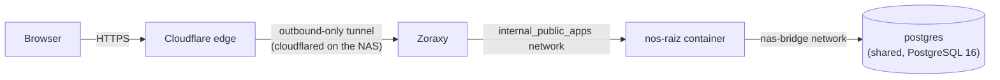

# 0010. MVP runs on the home NAS as a showcase and test environment

- **Status:** Accepted
- **Date:** 2026-11-22
- **Deciders:** Project owner
- **Supersedes:** [ADR-0005](0005-self-host-on-synology-with-docker.md)

## Context and problem statement

[ADR-0005](0005-self-host-on-synology-with-docker.md) assumed a Synology NAS. The actual home server is a **UGREEN NASync DH4300 Plus running UGOS (arm64)**. It already hosts other apps behind a Cloudflare tunnel and a Zoraxy reverse proxy, with a shared PostgreSQL 16 instance. The MVP is a family showcase and a functional test of the app, not the production platform. Where and how should it run?

## Decision drivers

- Reuse the existing home-lab setup and deploy routine
- Google sign-in and share links need a public HTTPS address ([ADR-0008](0008-oauth-only-sign-in.md))
- No inbound ports opened on the home router
- No hosting cost during the MVP
- Moving to production infrastructure later must be a deployment change, not a code change

## Decision outcome

Run the MVP on the home NAS, following the same conventions as the owner's other home-lab apps.

### Build and deploy

1. `scripts/build-and-push.sh` builds the image for `linux/amd64` and `linux/arm64` on the developer's machine, tags it from the `VERSION` file, and pushes it to the private LAN registry.
2. The script updates the image tag in `docker-compose.nas.yml`.
3. The compose file is pasted into the UGOS Docker UI. Nothing else is copied to the NAS.

CI never deploys: the registry and the NAS are reachable only from the home network.

### Public access

- A subdomain of `moreiralabs.org` points through the Cloudflare tunnel to Zoraxy, which routes it to the app.
- The app container publishes **no ports**; the tunnel is the only way in.

### Database

- The existing shared `postgres` container on `nas-bridge` hosts a dedicated `nosraiz` **database**, owned by a dedicated `nosraiz` role with no other privileges.
- `scripts/create-db-user.sh`, adapted from the Trading project, creates or updates the role and database.
- Migrations, run by the app, enable `pg_trgm` and `unaccent` (trusted extensions, installable by the database owner in PostgreSQL 13+) and create the tables.

### Container hardening

`read_only: true`, `cap_drop: [ALL]`, `no-new-privileges`, tmpfs for `/tmp`, non-root user. Two health endpoints: `/healthz` (process up, for Zoraxy) and `/api/health` (database reachable, for the Docker healthcheck).

### Backups

Out of scope for this decision. Backing up the `nosraiz` database is the NAS owner's responsibility until a backup strategy is decided; see [backup and restore](../../operations/backup-and-restore.md).

### When to move off the NAS

Move to production infrastructure, recorded in a new ADR, when any of these become true:

- The app is opened to people beyond the owner's family
- Open sign-up is enabled
- Uptime or support guarantees are needed

### Consequences

- **Good:** One deploy routine shared with the other home-lab apps.
- **Good:** No open router ports; Cloudflare provides TLS and DDoS protection.
- **Good:** No new database server to run.
- **Bad:** The app is publicly reachable, so invite-only sign-in and the protected view ([ADR-0009](0009-per-tree-roles-and-protected-view.md)) are essential, not optional.
- **Bad:** Sharing a PostgreSQL instance means a NAS-level database problem affects several apps.
- **Bad:** Availability depends on home power and internet; acceptable for a showcase.
