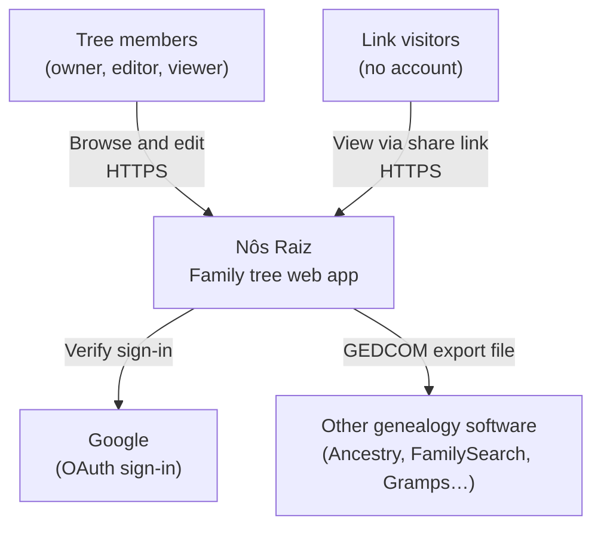
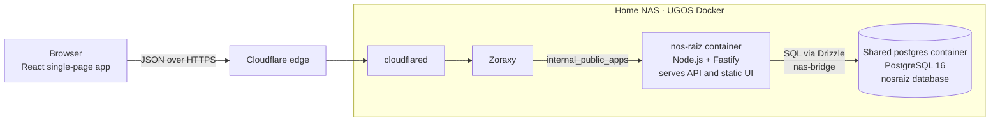
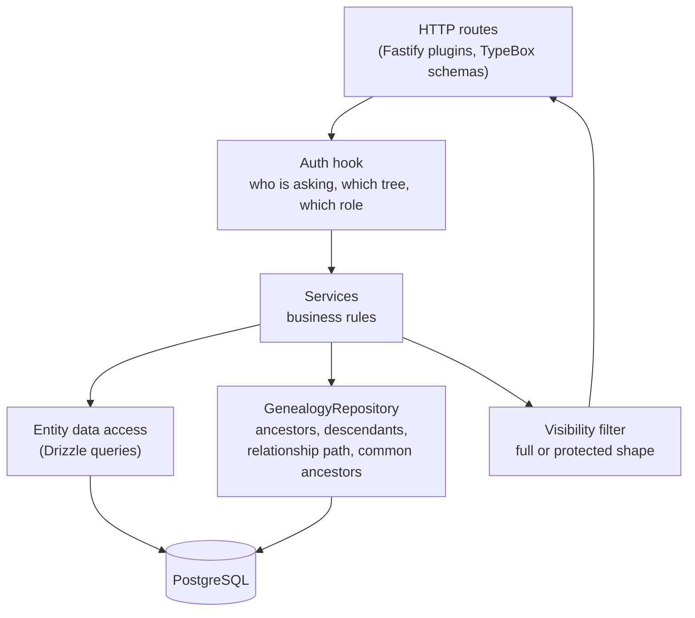
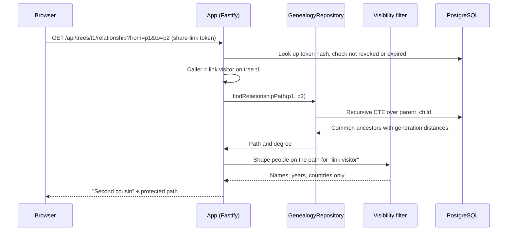

# Architecture overview

Nôs Raiz is a single web application backed by PostgreSQL. For the MVP it runs on the home NAS, reachable through a Cloudflare tunnel ([ADR-0010](decisions/0010-mvp-on-home-nas.md)). This document uses the [C4 model](https://c4model.com/) at the context and container levels.

## System context

Who uses the system and what it talks to.

## Containers

What runs, for the MVP on the home NAS.

| Container | Responsibility | Technology |
| --- | --- | --- |
| nos-raiz | REST API, Google sign-in, sessions, visibility filter, serving the built React UI, GEDCOM export | Node.js, Fastify, Drizzle ORM |
| postgres (shared) | Stores trees, members, people, relationships, events, places, sessions | PostgreSQL 16 with `pg_trgm` and `unaccent`, dedicated `nosraiz` database |

The UI is built at image build time and served as static files by the app container, so there is no separate web server.

## Backend structure

- **Routes** handle HTTP. Requests and responses are validated against TypeBox schemas from `packages/shared` ([ADR-0007](decisions/0007-rest-api-with-typebox-schemas.md)).
- **Auth hook** resolves the caller: a signed-in member with a role in this tree, a share-link visitor, or nobody. Routes declare the minimum role they need.
- **Services** hold business rules, for example "no cycles", "at most two biological parents", "a tree always has an owner", "living people cannot be made public".
- **Entity data access** is plain create, read, update and delete through Drizzle.
- **GenealogyRepository** is the only place that walks the family graph ([ADR-0003](decisions/0003-postgresql-as-primary-database.md)).
- **Visibility filter** shapes every person and event for the caller's role before it leaves the server ([ADR-0009](decisions/0009-per-tree-roles-and-protected-view.md)).

## Request flow example: a link visitor asks "How are we related?"

## Related documents

- [Data model](data-model.md)
- [Tech stack](tech-stack.md)
- [Deployment](../operations/deployment.md)
- [Security overview](../security/overview.md)
