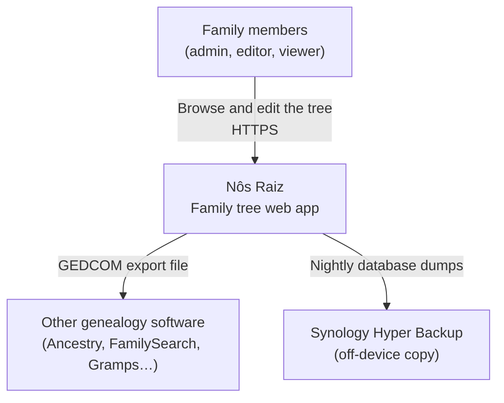
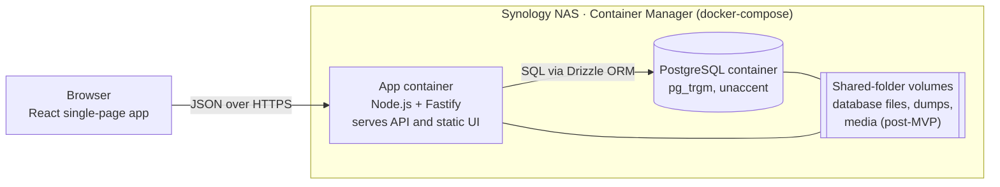
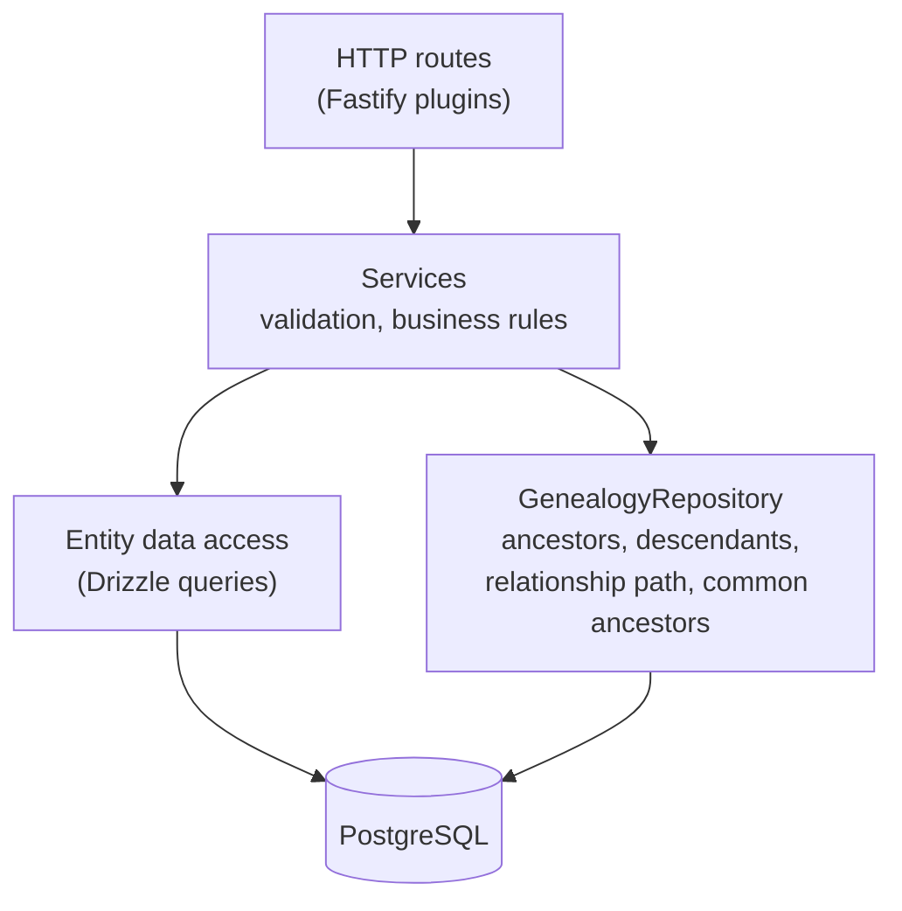
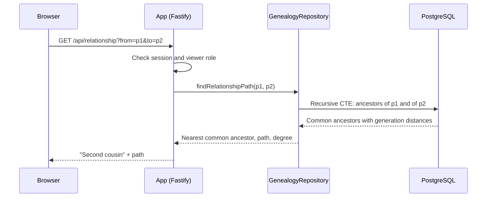

# Architecture overview

Nôs Raiz is a single web application backed by PostgreSQL, deployed as one docker-compose stack on a Synology NAS. This document uses the [C4 model](https://c4model.com/) at the context and container levels.

## System context

Who uses the system and what it talks to.

## Containers

What runs on the NAS.

| Container | Responsibility | Technology |
| --- | --- | --- |
| App | REST API, authentication, serving the built React UI, GEDCOM export, scheduled backup job | Node.js, Fastify, Drizzle ORM |
| PostgreSQL | Stores people, relationships, events, places, users and sessions | PostgreSQL with `pg_trgm` and `unaccent` extensions |

The UI is built at image build time and served as static files by the app container, so there is no separate web server container.

## Backend structure

- **Routes** handle HTTP, authentication and authorisation checks.
- **Services** hold business rules, for example "a person cannot be their own ancestor" and "at most two biological parents".
- **Entity data access** is plain create, read, update and delete through Drizzle.
- **GenealogyRepository** is the only place that walks the family graph. Isolating it keeps a future move to a graph database to one module. See [ADR-0003](decisions/0003-postgresql-as-primary-database.md).

## Request flow example: "How are we related?"

## Related documents

- [Data model](data-model.md)
- [Tech stack](tech-stack.md)
- [Deployment](../operations/deployment.md)
- [Security overview](../security/overview.md)
