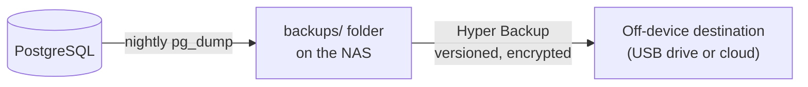

# Backup and restore

Family history is irreplaceable. Backups follow the 3-2-1 rule: three copies, on two kinds of storage, one off-site.

> **Status:** planned. The backup job and restore command will be added with the first application code.

## What is backed up

| Data | How | Where |
| --- | --- | --- |
| Database | Nightly `pg_dump` in custom format, run by the app's scheduled job | `/volume1/docker/nos-raiz/backups/` |
| Media (post-MVP) | Files on the shared folder | `/volume1/docker/nos-raiz/media/` |
| Configuration | `.env` and `docker-compose.yml` | `/volume1/docker/nos-raiz/` |

## Copies

1. **Live database** on the NAS.
2. **Nightly dumps** in `backups/`, kept for `BACKUP_RETENTION_DAYS` (default 30).
3. **Off-device copy:** Synology Hyper Backup copies the `nos-raiz` folder to a USB drive or cloud destination, versioned and with client-side encryption enabled. **Exclude `postgres/`.** A live database directory copied mid-write is not a consistent backup; the dumps in `backups/` are.

A GEDCOM export saved occasionally is a further, software-independent copy.

## Restore

1. Stop the app container in Container Manager (leave the database running).
2. Pick the dump to restore from `backups/` (or retrieve it from Hyper Backup first).
3. Restore it over the existing database with `pg_restore --clean --if-exists` (this drops and recreates every table). For a restore drill, restore into a separate, newly created database instead, so live data is untouched. The exact commands will be documented with the backup job, and must exist before MVP [story 8](../product/mvp.md#user-stories-and-acceptance-criteria) can pass.
4. Start the app container and check that the tree looks right.

## Restore drill

A backup that has never been restored is not a backup.

- Perform a test restore into a separate database **before the MVP is used for real data**, and then every 6 months.
- Record each drill in the table below.

| Date | Dump restored | Result | By |
| --- | --- | --- | --- |
| — | — | — | — |
