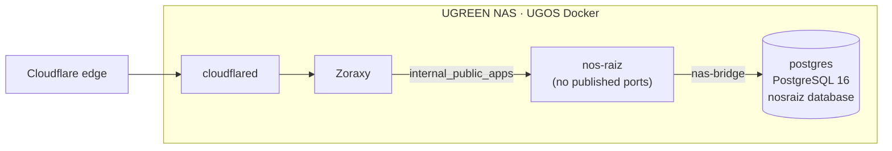

# Deployment

The MVP runs on the home NAS (UGREEN NASync DH4300 Plus, UGOS, arm64) as a family showcase and test environment, following the same conventions as the owner's other home-lab apps. See [ADR-0010](../architecture/decisions/0010-mvp-on-home-nas.md).

> **Status:** planned. The files referenced here (`docker-compose.nas.yml`, `scripts/build-and-push.sh`, `scripts/create-db-user.sh`, `.env.example`) will be added with the first application code.

> **Backups:** the app does not back up its own data. Backing up the `nosraiz` database on the NAS PostgreSQL is the NAS owner's responsibility. See [backup and restore](backup-and-restore.md).

## How it fits on the NAS



| Piece | Already exists on the NAS | Added for Nôs Raiz |
| --- | --- | --- |
| Cloudflare tunnel (`cloudflared`) | Yes | A public hostname, e.g. `nosraiz.moreiralabs.org` |
| Zoraxy | Yes | A route from that hostname to `http://nos-raiz:<PORT>` |
| `internal_public_apps` network | Yes | The app joins it |
| `nas-bridge` network | Yes | The app joins it |
| `postgres` container (PostgreSQL 16) | Yes | A `nosraiz` role and database |
| Private LAN registry | Yes | The `nos-raiz` image |

## Prerequisites

- Docker on the developer's machine (for building and pushing)
- SSH access to the NAS, or Docker CLI access to it (for creating the database user)
- A Google Cloud OAuth client whose authorised redirect URI points at the app's sign-in callback on `https://<hostname>` (the exact path is set by the authentication library, still to be chosen)

## Configuration

Settings come from `.env`, copied from `.env.example`. It is baked into the image at build time, so the NAS needs nothing but the compose file. The image must only be pushed to the private LAN registry.

| Variable | Purpose |
| --- | --- |
| `REGISTRY` | Private LAN registry, `host:port` |
| `DATABASE_URL` | `postgresql://nosraiz:<password>@postgres:5432/nosraiz`; password at least 24 characters |
| `PUBLIC_URL` | `https://<hostname>`, used for OAuth redirects and share links |
| `GOOGLE_CLIENT_ID`, `GOOGLE_CLIENT_SECRET` | Google OAuth client |
| `SESSION_SECRET` | Signs session cookies; long and random |
| `OWNER_EMAIL` | Google email of the first tree owner |
| `TREE_NAME` | Name of the first tree, created on first start |
| `PORT` | Port the app listens on inside the container |

## First install

1. **Create the database role and database** on the NAS PostgreSQL:
   ```bash
   NAS_SSH=<user>@<nas-address> scripts/create-db-user.sh
   ```
   The script reads `DATABASE_URL` from `.env` and asks for confirmation. It is safe to re-run, and the password never appears in arguments, logs or the process list.
2. **Build and push** the image:
   ```bash
   scripts/build-and-push.sh
   ```
   This builds `linux/amd64` and `linux/arm64`, tags the image from `VERSION`, pushes it to the registry, and updates the tag in `docker-compose.nas.yml`.
3. **Deploy:** paste `docker-compose.nas.yml` into the UGOS Docker UI. On start, the app applies any pending migrations (enabling `pg_trgm` and `unaccent`, creating tables) before accepting requests, then creates the first tree if none exists.
4. **Zoraxy:** route the hostname to `http://nos-raiz:<PORT>` with health check path `/healthz`.
5. **Cloudflare tunnel:** point the public hostname at Zoraxy.
6. **Sign in** at `https://<hostname>` with the `OWNER_EMAIL` Google account. That account becomes the owner of the first tree and can invite family members.

## Upgrades

1. Read the [changelog](../../CHANGELOG.md).
2. Bump `VERSION`, then run `scripts/build-and-push.sh`.
3. Paste the updated `docker-compose.nas.yml` into the UGOS Docker UI. Migrations run on start.

## Health checks

| Endpoint | Returns | Used by |
| --- | --- | --- |
| `/healthz` | `ok` while the process is up; never touches the database | Zoraxy upstream check, so a database blip doesn't take the site offline |
| `/api/health` | `{"status":"ok"}`, or HTTP 503 when the database is unreachable | The image's Docker healthcheck, so UGOS shows the container as unhealthy |

## Container hardening

`read_only: true`, tmpfs for `/tmp`, `cap_drop: [ALL]`, `security_opt: [no-new-privileges:true]`, non-root user, no published ports.

## Moving off the NAS

The NAS is for the MVP only. Production infrastructure will be chosen in a new ADR before the app is opened beyond the family; see the triggers in [ADR-0010](../architecture/decisions/0010-mvp-on-home-nas.md#when-to-move-off-the-nas).
