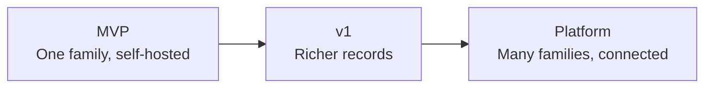

# Roadmap

The roadmap moves from one family's private tree to a diaspora-wide platform. Phases are ordered by dependency, not dated.

## MVP: one family, self-hosted

Detailed in [MVP scope](mvp.md).

- People, relationships, events, places, fuzzy dates
- Tree view, person pages, relationship finder, fuzzy name search
- Accounts with admin, editor and viewer roles
- GEDCOM export, nightly backups

**Gate to v1:** MVP exit criteria met and the family has used it for real entry.

## v1: richer records

- GEDCOM import (5.5.1 and 7.0)
- Photos and documents attached to people and events, stored on the NAS
- Sources and citations (parish register, civil record, oral history)
- Portuguese and Kriolu user interface
- Printable charts and family group sheets
- Change history: who changed what, with undo

**Gate to platform:** Data model proven stable in real use; remote-access and privacy approach settled.

## Platform: many families, connected

- Multiple independent trees with their own members and permissions
- Hosted option alongside self-hosting
- Public profiles for deceased ancestors, with living people always private
- Cross-tree matching ("this Gonçalves from Brava, born c. 1872, may be the same person in another family's tree")
- Shared place gazetteer for Cape Verde islands and diaspora communities
- Re-evaluate the database for graph workloads at this scale; see [ADR-0003](../architecture/decisions/0003-postgresql-as-primary-database.md)
