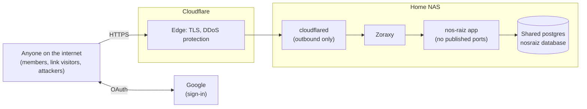

# Threat model

Scope: the MVP, running on the home NAS and publicly reachable through a Cloudflare tunnel ([ADR-0010](../architecture/decisions/0010-mvp-on-home-nas.md)). Revisit this document before moving to production infrastructure or opening sign-up.

## Assets

| Asset | Why it matters |
| --- | --- |
| Personal details of family members | Full names with exact birth dates, birthplaces and maiden names enable identity theft and answer common security questions |
| The family history as a whole | Years of irreplaceable research and recorded oral history |
| Member accounts and share links | Grant read or write access to the above |
| The NAS and its other apps | A compromised app must not become a way into the rest of the home network |

## Trust boundaries

The router has no open inbound ports. Everything reaches the app through Cloudflare.

## Threats and mitigations

| # | Threat | Impact | Mitigation | Status |
| --- | --- | --- | --- | --- |
| T1 | A forwarded share link exposes living relatives' identity details | High | Protected view for every person: year and country only, no notes. Living people can never be made public | Designed ([ADR-0009](../architecture/decisions/0009-per-tree-roles-and-protected-view.md)) |
| T2 | An API endpoint returns protected fields to a viewer or link visitor | High | Single visibility filter in the API; per-role, per-endpoint field tests | Designed |
| T3 | A stranger signs in with any Google account | High | Invite-only: only invited verified emails are accepted | Designed |
| T4 | A viewer edits or deletes data | Medium | Server-side role checks on every route | Designed |
| T5 | Share link token guessed or leaked | Medium | 128-bit random tokens, hashed at rest, revocable, optional expiry, `no-referrer`, `noindex` | Designed |
| T6 | Session hijacking | Medium | `HttpOnly`, `Secure`, `SameSite` cookies; HTTPS everywhere via Cloudflare; session revocation | Designed |
| T7 | SQL injection or cross-site scripting | High | Parameterised queries (Drizzle), schema validation, React escaping, Content-Security-Policy | Designed |
| T8 | Data loss: disk failure, accidental deletion, bad edit, ransomware | High | Not yet mitigated by the app; backup strategy pending | **Open** |
| T9 | Secrets leaked through the repository or image | High | `.env` never committed; image pushed only to the private LAN registry; GitHub secret scanning | Designed |
| T10 | Compromised app container used to attack the NAS | High | Read-only filesystem, non-root, all capabilities dropped, `no-new-privileges`; only the networks it needs | Designed |
| T11 | Compromised app reads other apps' data in the shared PostgreSQL | Medium | Dedicated `nosraiz` role that owns only its database; `CONNECT` revoked from `PUBLIC` | Designed |
| T12 | Vulnerable dependency | Medium | `pnpm audit` in CI, Dependabot, pinned base images | Designed |
| T13 | Denial of service | Low | Cloudflare edge protection; per-IP rate limiting | Designed |

## Accepted risks

- **Maiden names are visible** in the protected view, because names and relationships are the purpose of the tree. See [ADR-0009](../architecture/decisions/0009-per-tree-roles-and-protected-view.md).
- **Home availability:** power or internet outages take the app offline. Acceptable for a family showcase.
- **No backups yet** (T8): until the owner's backup strategy is in place, data on the NAS can be lost.
