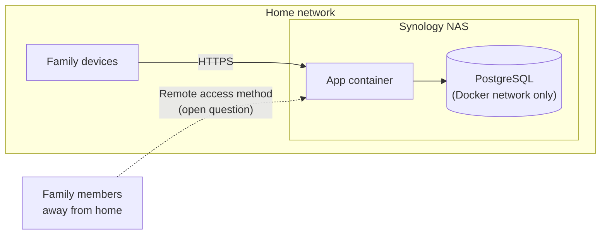

# Threat model

Scope: the MVP, running on a home Synology NAS for one family. Revisit this document before the platform phase, when the app becomes multi-family and possibly internet-hosted.

## Assets

| Asset | Why it matters |
| --- | --- |
| Personal data of living people | Names, birth dates, birthplaces and mothers' maiden names enable identity theft and answer common security questions |
| Family history as a whole | Years of irreplaceable work and recorded oral history |
| User accounts | Grant read or write access to the above |
| The NAS itself | Hosts other household data; a compromised app must not become a way in |

## Trust boundaries

The database is reachable only from the app container. Nothing on the NAS is port-forwarded to the internet.

## Threats and mitigations

| # | Threat | Impact | Mitigation | Status |
| --- | --- | --- | --- | --- |
| T1 | Data loss: disk failure, accidental deletion, ransomware on the NAS | High | Nightly `pg_dump`; Hyper Backup to an off-device, versioned, encrypted destination; tested restore | Planned |
| T2 | App exposed to the internet and attacked (credential stuffing, exploits) | High | Do not port-forward the app directly; prefer VPN or Tailscale; if a reverse proxy is used, HTTPS plus rate limiting | **Open: remote access decision** |
| T3 | Weak or reused family passwords | Medium | Argon2id hashing, 12-character minimum, common-password check, login rate limiting | Planned |
| T4 | A viewer edits or deletes data | Medium | Server-side role checks on every route | Planned |
| T5 | Bad edit corrupts the tree (wrong parent, accidental delete) | Medium | Confirmation on deletes; nightly backups for recovery; audit log and undo in v1 | Partly planned |
| T6 | Living people's details shared outside the family via export | Medium | Export restricted to editors and admins; "privatise living people" export option | Planned |
| T7 | SQL injection or cross-site scripting | High | Parameterised queries (Drizzle), schema validation, React escaping, Content-Security-Policy | Planned |
| T8 | Secrets leaked through the repository | High | `.env` on the NAS only; `.env.example` without values; secret scanning on GitHub | Planned |
| T9 | Vulnerable dependency | Medium | `npm audit` in CI, Dependabot, pinned base images | Planned |
| T10 | Database reachable from the network | High | PostgreSQL bound to the internal Docker network only; no published port | Planned |

## Remote access options (for T2)

| Option | Exposure to the internet | Effort for family members | Notes |
| --- | --- | --- | --- |
| Tailscale | None (private mesh network) | Install an app once per device | Strong default for a family |
| Synology VPN Server | One VPN port | Configure a VPN profile per device | Built into the NAS |
| Reverse proxy + HTTPS (Synology or Caddy) | The app is public | None, just a URL | Needs strong auth, rate limiting and timely updates; highest risk |

Recommendation to evaluate: Tailscale, because it exposes nothing publicly. The decision will be recorded as a new ADR.
